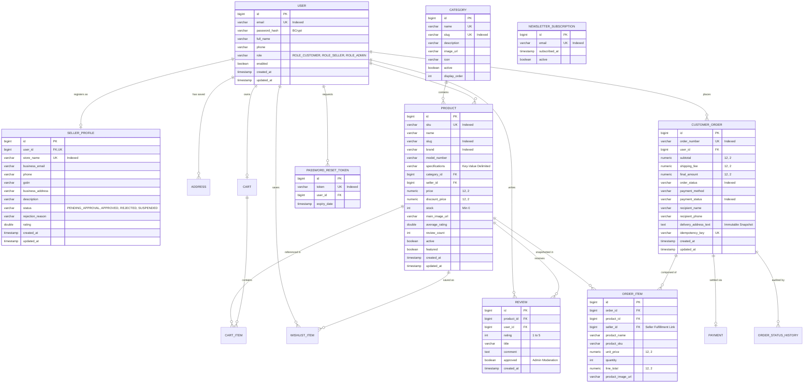

# SP MART — Database Design Document & ER Schema Specification

This document details the database architecture, entity relationships, indexes, constraints, multi-role data structures, and audit policies for the **SP MART** electronics e-commerce platform.

---

## 1. Architecture Overview

- **Development Engine:** H2 Database Engine 2.3+ in persistent file mode (`./data/spmartdb`).
- **Development JDBC URL:** `jdbc:h2:file:./data/spmartdb;DB_CLOSE_DELAY=-1;DB_CLOSE_ON_EXIT=FALSE;AUTO_RECONNECT=TRUE`
- **Testing Engine:** In-memory H2 (`jdbc:h2:mem:spmart_testdb;DB_CLOSE_DELAY=-1`) for fast, isolated test execution.
- **Production Engine:** MySQL 8.0+ enabled via `application-mysql.properties` (`--spring.profiles.active=mysql`).
- **Portability:** Built strictly on JPA 3.1 & Hibernate 6.5 standards using ANSI SQL types (`BIGINT`, `VARCHAR`, `DECIMAL(12,2)`, `TIMESTAMP`), guaranteeing zero vendor lock-in.

---

## 2. Entity-Relationship Diagram (ERD)



---

## 3. Database Schema Tables & Column Definitions

### `users`
| Column | Type | Constraints | Description |
|---|---|---|---|
| `id` | `BIGINT` | PRIMARY KEY, AUTO_INCREMENT | Unique user identifier |
| `email` | `VARCHAR(150)` | NOT NULL, UNIQUE, INDEX | Login email address |
| `password` | `VARCHAR(255)` | NOT NULL | BCrypt hashed password |
| `full_name` | `VARCHAR(100)` | NOT NULL | Customer or owner name |
| `phone` | `VARCHAR(20)` | NULL | Mobile contact |
| `role` | `VARCHAR(30)` | NOT NULL | `ROLE_CUSTOMER`, `ROLE_SELLER`, `ROLE_ADMIN` |
| `enabled` | `BOOLEAN` | NOT NULL, DEFAULT TRUE | Account active flag |
| `created_at` | `TIMESTAMP` | NOT NULL | Account creation time |
| `updated_at` | `TIMESTAMP` | NULL | Last modification time |

### `seller_profiles`
| Column | Type | Constraints | Description |
|---|---|---|---|
| `id` | `BIGINT` | PRIMARY KEY, AUTO_INCREMENT | Unique profile identifier |
| `user_id` | `BIGINT` | NOT NULL, UNIQUE, FK (`users.id`) | 1-to-1 link with user |
| `store_name` | `VARCHAR(150)` | NOT NULL, UNIQUE | Public merchant storefront name |
| `business_email`| `VARCHAR(150)` | NOT NULL | Merchant business email |
| `phone` | `VARCHAR(25)` | NOT NULL | Merchant phone number |
| `gstin` | `VARCHAR(30)` | NULL | Indian GST Identification Number |
| `business_address`| `VARCHAR(500)`| NULL | Warehouse or business address |
| `status` | `VARCHAR(30)` | NOT NULL | `PENDING_APPROVAL`, `APPROVED`, `REJECTED`, `SUSPENDED` |
| `rejection_reason`| `VARCHAR(500)`| NULL | Administrator review commentary |
| `rating` | `DOUBLE` | DEFAULT 5.0 | Average seller rating |

### `products`
| Column | Type | Constraints | Description |
|---|---|---|---|
| `id` | `BIGINT` | PRIMARY KEY, AUTO_INCREMENT | Unique product identifier |
| `sku` | `VARCHAR(60)` | NOT NULL, UNIQUE, INDEX | Stock Keeping Unit |
| `name` | `VARCHAR(200)` | NOT NULL | Full product title |
| `slug` | `VARCHAR(220)` | NOT NULL, INDEX | URL-friendly slug |
| `brand` | `VARCHAR(80)` | NOT NULL, INDEX | Electronics manufacturer |
| `model_number`| `VARCHAR(80)` | NULL | Manufacturer model number |
| `specifications`| `TEXT` | NULL | Pipe-separated hardware specs |
| `category_id` | `BIGINT` | NOT NULL, FK (`categories.id`) | Product category |
| `seller_id` | `BIGINT` | NULL, FK (`users.id`) | Selling merchant |
| `price` | `NUMERIC(12,2)`| NOT NULL | MRP / Original price |
| `discount_price`| `NUMERIC(12,2)`| NULL | Sale price (if discounted) |
| `stock` | `INT` | NOT NULL, CHECK (`stock >= 0`)| Units available |
| `average_rating`| `DOUBLE` | NOT NULL, DEFAULT 0.0 | Calculated aggregate star rating |
| `review_count`| `INT` | NOT NULL, DEFAULT 0 | Count of approved verified reviews |
| `active` | `BOOLEAN` | NOT NULL, DEFAULT TRUE | Public visibility |
| `featured` | `BOOLEAN` | NOT NULL, DEFAULT FALSE | Featured on hero / deals |

---

## 4. Production MySQL 8 Migration Guide

To switch from H2 to MySQL in a production or staging environment:

1. **Create the Database in MySQL:**
   ```sql
   CREATE DATABASE spmartdb CHARACTER SET utf8mb4 COLLATE utf8mb4_unicode_ci;
   ```

2. **Configure Credentials in Environment or properties:**
   In `src/main/resources/application-mysql.properties`, customize datasource parameters or supply environment variables:
   - `MYSQL_HOST` (default: `localhost`)
   - `MYSQL_PORT` (default: `3306`)
   - `MYSQL_DATABASE` (default: `spmartdb`)
   - `MYSQL_USER` (default: `root`)
   - `MYSQL_PASSWORD` (default: `root`)

3. **Launch with Active Profile:**
   ```powershell
   mvn spring-boot:run -Dspring-boot.run.profiles=mysql
   ```
   Hibernate will automatically generate all schemas, foreign keys, and indexes on startup via `spring.jpa.hibernate.ddl-auto=update`, and `DataInitializer` will seed the 12 electronics categories and demonstration merchant accounts.
