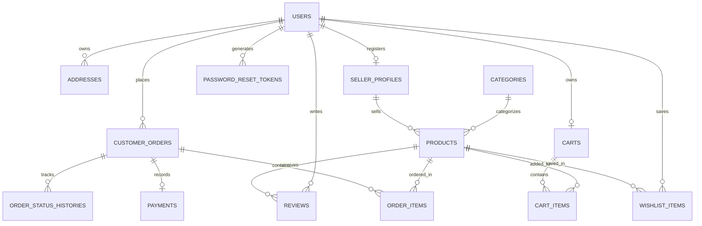

# B.TECH ARTIFICIAL INTELLIGENCE AND DATA SCIENCE
## CAPSTONE PROJECT TECHNICAL DOCUMENTATION REPORT

---

# SP MART — PREMIUM ELECTRONICS E-COMMERCE WEB APPLICATION WITH CATALOG-GROUNDED ARTIFICIAL INTELLIGENCE ARCHITECTURE

**Academic Year:** 2025 – 2026  
**Degree:** Bachelor of Technology (B.Tech)  
**Department:** Artificial Intelligence and Data Science  
**Technology Stack:** Java 21 LTS, Spring Boot 3.3.4, Spring Security 6, Spring Data JPA, Hibernate, Thymeleaf, H2/MySQL, PWA, HTML5/CSS3/JavaScript  
**Repository:** [https://github.com/Shipraprasath/sp-mart](https://github.com/Shipraprasath/sp-mart)  

---

## TABLE OF CONTENTS

1. [Abstract & Executive Summary](#1-abstract--executive-summary)
2. [Introduction & Problem Statement](#2-introduction--problem-statement)
3. [Literature Survey & Technological Landscape](#3-literature-survey--technological-landscape)
4. [System Requirements Specification (SRS)](#4-system-requirements-specification-srs)
5. [System Architecture & Design Patterns](#5-system-architecture--design-patterns)
6. [Database Design & Data Modeling](#6-database-design--data-modeling)
7. [Artificial Intelligence Engine Architecture](#7-artificial-intelligence-engine-architecture)
8. [Multi-Role Modules & Core Features](#8-multi-role-modules--core-features)
9. [Cybersecurity & Data Integrity Implementation](#9-cybersecurity--data-integrity-implementation)
10. [Testing, Quality Assurance & Verification](#10-testing-quality-assurance--verification)
11. [DevOps, Cloud Deployment & PWA Configuration](#11-devops-cloud-deployment--pwa-configuration)
12. [Conclusion & Future Scope](#12-conclusion--future-scope)
13. [References & Academic Bibliography](#13-references--academic-bibliography)

---

## 1. ABSTRACT & EXECUTIVE SUMMARY

Modern consumer electronics retail involves complex customer decision journeys driven by technical specifications, variable pricing, feature comparisons, and delivery logistics. Traditional e-commerce architectures often suffer from detached third-party chat widgets, ungrounded Large Language Model (LLM) hallucinations, rigid multi-role security boundaries, and monolithic backends.

**SP MART** is an enterprise-grade, full-stack electronics e-commerce web application engineered to solve these challenges. Developed as a Capstone Project for **B.Tech Artificial Intelligence and Data Science**, the system combines robust enterprise Java back-end architecture with real-time catalog-grounded AI recommendations and modern Progressive Web App (PWA) mobility.

### Key Highlights:
- **Enterprise Core:** Powered by **Java 21 LTS** and **Spring Boot 3.3.4**, implementing a decoupled Multi-Tier Layered Architecture (`Controller` → `Service` → `Repository` → `Entity/DTO`).
- **Grounded AI Shopping Engine:** Built with a catalog-anchored intelligence pipeline that parses natural language budget constraints (e.g., *"laptops under ₹75,000"*, *"phones below 30k"*), performs real-time spec matrix comparisons (e.g., *"iPhone 15 Pro vs Samsung S24 Ultra"*), and eliminates hallucinations through strict relational database grounding.
- **Role-Based Access Control (RBAC):** Three distinct actor roles (`ROLE_CUSTOMER`, `ROLE_SELLER`, `ROLE_ADMIN`) secured via **Spring Security 6**, BCrypt cryptographic password hashing (strength factor 12), and Cookie-based CSRF protection.
- **Multi-Tenant Seller Governance:** Autonomous merchant portal featuring real-time business metrics, product CRUD operations, and milestone-based shipment management, subject to strict Administrator verification.
- **PWA Mobility & Audio UX:** Native-like mobile installation via Web App Manifest, Service Worker caching, and synthesized Web Audio API milestone celebrations.
- **Zero-Friction Cloud Deployment:** Automated CI/CD pipeline integrated with GitHub and Railway cloud PaaS for 24/7 high-availability deployment.

---

## 2. INTRODUCTION & PROBLEM STATEMENT

### 2.1 Background
The digital retail market for consumer electronics has grown exponentially. Electronics purchases differ substantially from standard consumer goods due to high average order values (AOV), intricate hardware specifications (refresh rates, processor lithography, camera sensor sizes, inverter efficiency), and rapid obsolescence cycles.

### 2.2 Problem Statement
Existing consumer electronics marketplaces frequently exhibit three critical deficiencies:
1. **The Recommendation Gap & AI Hallucinations:** Generic conversational bots frequently suggest out-of-stock items, obsolete configurations, or non-existent hardware specs because they lack direct coupling to live database inventory.
2. **Security & Role Bleed Vulnerabilities:** Many academic applications fail to enforce strict horizontal and vertical privilege separation between merchants, customers, and administrative staff, leading to unauthorized order status manipulation and data tampering.
3. **Complex Setup & Lack of True Multi-Platform Portability:** Monolithic applications often lack responsive mobile interfaces, offline-capable progressive web apps (PWAs), or turnkey cloud deployment configurations.

### 2.3 Proposed Solution: SP MART
SP MART addresses these bottlenecks through an integrated architectural approach:
- A catalog-grounded AI assistant running directly against persistent Spring Data JPA repositories.
- Multi-role isolation enforced at the HTTP filter chain, method security, and database query layers.
- A modern Cyber-Obsidian and Titanium Glassmorphism user interface designed for both desktop workstations and mobile smartphones with PWA installation.

---

## 3. LITERATURE SURVEY & TECHNOLOGICAL LANDSCAPE

| Technology | Selected Version | Architectural Justification |
|---|---|---|
| **Java** | 21 LTS | Long-Term Support release with virtual threads (Project Loom), enhanced pattern matching, record patterns, and modern performance improvements. |
| **Spring Boot** | 3.3.4 | Industry-standard convention-over-configuration enterprise framework providing embedded Tomcat 10, automated metrics, and Spring 6 core features. |
| **Spring Security** | 6.3.3 | Declarative security framework providing filter-chain authentication, BCrypt hashing, CSRF token repositories, and method-level access controls. |
| **Spring Data JPA & Hibernate** | 6.5.3 | High-performance Object-Relational Mapping (ORM) implementing JPA 3.1 specifications with automated repository query generation. |
| **H2 & MySQL** | 2.2 / 8.0 | Dual-mode persistence: zero-configuration file-based H2 database (`./data/spmartdb`) for development/testing, and externalized MySQL 8 production profile. |
| **Thymeleaf** | 3.1.2 | Modern server-side Java template engine that parses natural HTML templates without breaking browser preview capability. |
| **Progressive Web App (PWA)** | W3C Standard | Web App Manifest + Service Worker architecture enabling native Android and iOS mobile app download and home-screen launching. |
| **Maven** | 3.9+ | Declarative dependency management and multi-phase build lifecycle automation (`compile`, `test`, `package`). |

---

## 4. SYSTEM REQUIREMENTS SPECIFICATION (SRS)

### 4.1 Functional Requirements

#### Module A: Authentication & User Management
- **FR-01:** Secure user registration with email uniqueness validation, 10-digit Indian mobile validation, and minimum 6-character password rules.
- **FR-02:** Multi-role login supporting Customer, Approved Seller, and Administrator accounts.
- **FR-03:** Password reset token workflow with cryptographic UUID generation and expiration timestamp verification.
- **FR-04:** Persistent address book management supporting multiple delivery destinations.

#### Module B: Catalog & Discovery
- **FR-05:** Hierarchical browsing across 12 electronics categories (Smartphones, Laptops, 4K TVs, Air Conditioners, etc.).
- **FR-06:** Multi-criteria filtering by category slug, brand, minimum price, maximum price, and star ratings.
- **FR-07:** Real-time search by keywords against product names, model numbers, brands, and descriptions.

#### Module C: Cart & Checkout Workflow
- **FR-08:** Persistent session and database shopping cart with real-time stock availability verification.
- **FR-09:** Dynamic Free Express Delivery calculation (free for orders $\ge$ ₹500, flat ₹40 fee otherwise).
- **FR-10:** Multi-step checkout with delivery address selection, payment gateway simulator (UPI QR, Google Pay, Paytm, Cards, COD), and atomic stock decrement.

#### Module D: Order Tracking & Customer Service
- **FR-11:** 6-stage visual milestone tracker: `PLACED` → `CONFIRMED` → `PROCESSING` → `SHIPPED` → `OUT_FOR_DELIVERY` → `DELIVERED`.
- **FR-12:** Self-service customer order cancellation before shipment milestone.
- **FR-13:** Post-delivery verified product reviews and 1-5 star ratings with administrative moderation.

#### Module E: Seller Back-Office (SaaS Merchant Portal)
- **FR-14:** Dedicated seller registration workflow requiring business name, GSTIN, store description, and administrator approval.
- **FR-15:** Merchant analytics dashboard displaying Total Revenue, Total Orders, Active Listings, and Low-Stock Warnings ($\le 10$ units).
- **FR-16:** Autonomous product CRUD operations strictly scoped to the authenticated seller's inventory.
- **FR-17:** Merchant order milestone updates (`PROCESSING` → `SHIPPED` → `DELIVERED`).

#### Module F: Administrator Operations & Governance
- **FR-18:** Executive KPI dashboard with platform-wide revenue, order volumes, customer count, and low-stock items.
- **FR-19:** Seller approval and account suspension controls.
- **FR-20:** Customer review moderation with approval and deletion controls.
- **FR-21:** Global category and product inventory overrides.

#### Module G: Catalog-Grounded AI Shopping Assistant
- **FR-22:** Floating conversational AI interface accessible across all consumer routes.
- **FR-23:** Natural language regex and tokenized budget extraction (e.g. ₹30,000, 80k, under 15000).
- **FR-24:** Multi-device comparison matrix generator with side-by-side technical specification breakdown.
- **FR-25:** Grounded recommendation cards with real-time inventory links.

---

### 4.2 Non-Functional Requirements
- **NFR-01 (Performance):** Page render and API response latency under 300 ms on standard 4G mobile connections.
- **NFR-02 (Security):** Zero plain-text password persistence; BCrypt strength 12; HttpOnly and SameSite CSRF cookies.
- **NFR-03 (Scalability):** Stateless Web tier capable of horizontal scaling behind a reverse proxy.
- **NFR-04 (Usability):** Responsive design adhering to WCAG 2.1 AA accessibility guidelines across screen widths from 360px to 4K displays.

---

## 5. SYSTEM ARCHITECTURE & DESIGN PATTERNS

### 5.1 Layered Architecture Overview

```
+-------------------------------------------------------------------------+
|                         PRESENTATION LAYER                              |
|   Thymeleaf 3 Templates | HTML5 | CSS3 Design Tokens | PWA Service Worker|
|   Web Audio API Chime   | JavaScript ES6+ Async Fetch | Mobile Manifest |
+------------------------------------+------------------------------------+
                                     | HTTP / HTTPS Request
                                     v
+-------------------------------------------------------------------------+
|                          SECURITY FILTER CHAIN                          |
|   Spring Security 6 | CookieCsrfTokenRepository | BCryptPasswordEncoder |
|   SessionManagement | Role-Based RequestMatchers | CustomUserDetails    |
+------------------------------------+------------------------------------+
                                     | Authenticated Principal
                                     v
+-------------------------------------------------------------------------+
|                           CONTROLLER LAYER                              |
|   HomeController       | ProductCatalogController | CartController      |
|   CheckoutController   | AuthController           | OrderController     |
|   SellerController     | AdminController          | AiAssistantController|
+------------------------------------+------------------------------------+
                                     | DTOs / Method Invocations
                                     v
+-------------------------------------------------------------------------+
|                            SERVICE LAYER                                |
|   ProductService       | CartService              | OrderService        |
|   UserService          | SellerService            | ReviewService       |
|   AiAssistantService   | PaymentService           | PasswordResetService|
+------------------------------------+------------------------------------+
                                     | Domain Entities / Business Logic
                                     v
+-------------------------------------------------------------------------+
|                           DATA ACCESS LAYER                             |
|   Spring Data JPA Repositories | Hibernate ORM 6.5 | EntityManager      |
+------------------------------------+------------------------------------+
                                     | JDBC / SQL Statements
                                     v
+-------------------------------------------------------------------------+
|                           PERSISTENCE LAYER                             |
|   Development: Persistent H2 Database (./data/spmartdb.mv.db)           |
|   Production:  MySQL 8.0 Enterprise Database                            |
+-------------------------------------------------------------------------+
```

### 5.2 Design Patterns Utilized
1. **Model-View-Controller (MVC):** Strict separation of view rendering (Thymeleaf), business routing (Controllers), and business state (Entities/DTOs).
2. **Repository Pattern:** Decouples domain logic from SQL persistence through Spring Data JPA interfaces.
3. **Service Layer Pattern:** Centralizes transactional boundaries (`@Transactional`) and multi-entity orchestrations.
4. **Data Transfer Object (DTO) Pattern:** Prevents over-posting attacks and isolates internal database entities from external form payloads.
5. **State Machine Pattern:** Governs the immutable transition of customer orders through defined statuses (`PLACED` → `DELIVERED`).
6. **Strategy Pattern:** Implemented in the `AiAssistantService` to execute contextual handlers based on query intent (Budget Search, Spec Comparison, Tech Explainer).

---

## 6. DATABASE DESIGN & DATA MODELING

### 6.1 Entity-Relationship (ER) Architecture



### 6.2 Key Relational Tables Schema Summary

| Table Name | Primary Key | Key Attributes & Constraints | Foreign Keys |
|---|---|---|---|
| **`users`** | `id` (BIGINT) | `email` (UNIQUE), `password` (BCrypt), `full_name`, `phone`, `role`, `enabled` | None |
| **`seller_profiles`** | `id` (BIGINT) | `store_name` (UNIQUE), `gstin`, `status` (`PENDING`, `APPROVED`, `SUSPENDED`) | `user_id` → `users(id)` |
| **`categories`** | `id` (BIGINT) | `name`, `slug` (UNIQUE), `description`, `icon`, `image_url` | None |
| **`products`** | `id` (BIGINT) | `name`, `slug` (UNIQUE), `brand`, `model_number`, `price`, `discount_percentage`, `stock_quantity`, `average_rating`, `active` | `category_id` → `categories(id)`, `seller_id` → `seller_profiles(id)` |
| **`customer_orders`** | `id` (BIGINT) | `order_number` (UNIQUE), `order_date`, `status`, `total_amount`, `shipping_fee`, `delivery_notes` | `user_id` → `users(id)`, `address_id` → `addresses(id)` |
| **`order_items`** | `id` (BIGINT) | `quantity`, `unit_price`, `subtotal` | `order_id` → `customer_orders(id)`, `product_id` → `products(id)` |
| **`payments`** | `id` (BIGINT) | `payment_method`, `payment_status`, `transaction_id`, `amount`, `payment_date` | `order_id` → `customer_orders(id)` |
| **`reviews`** | `id` (BIGINT) | `rating` (1-5), `headline`, `comment`, `approved`, `created_at` | `product_id` → `products(id)`, `user_id` → `users(id)` |

---

## 7. ARTIFICIAL INTELLIGENCE ENGINE ARCHITECTURE

### 7.1 Architecture & Flow Pipeline
The SP MART AI Shopping Assistant is designed around **deterministic database grounding** to provide fast, hallucination-free product intelligence:

```
[ User Natural Language Query ]
               |
               v
[ Intent Classification & Tokenizer ]
  |-- Check for Comparison keywords ("vs", "compare", "difference")
  |-- Check for Spec Explanation ("what is OLED", "inverter vs normal")
  \-- Check for Budget & Category intent ("phone under 30000", "soundbar below 15k")
               |
               v
[ Entity & Parameter Extraction ]
  |-- Natural Language Budget Parser: Regex `[0-9]+(?:,[0-9]+)*` with multiplier (k, thousand, lakh)
  |-- Brand Extractor: Token set lookup (Apple, Samsung, Sony, Dell, LG, HP, etc.)
  \-- Category Slug Matcher: Keyword map lookup (smartphones, laptops, televisions, etc.)
               |
               v
[ Spring Data JPA Dynamic Repository Query ]
  `productRepository.searchForAiAssistant(brand, minPrice, maxPrice, categoryId, keyword, Pageable)`
               |
               v
[ Contextual Synthesizer & Markdown Formatter ]
  |-- Conversational Markdown explanation
  |-- Side-by-side comparison matrix (spec, price, rating, discount, verdict)
  |-- Suggested follow-up prompt chips
  \-- Interactive Rich Product Card DTOs (id, slug, image, rating, formatted price)
               |
               v
[ Client-Side Floating Widget Render ]
```

### 7.2 Natural Language Budget Extractor Implementation
```java
private BigDecimal extractBudget(String query) {
    Pattern pattern = Pattern.compile(
        "(?:under|below|less than|budget|within|upto|up to)\\s*(?:rs\\.?|inr|₹)?\\s*([0-9]+(?:,[0-9]+)*)(?:\\s*(k|thousand|lakh|lac))?", 
        Pattern.CASE_INSENSITIVE
    );
    Matcher matcher = pattern.matcher(query);
    if (matcher.find()) {
        String numStr = matcher.group(1).replace(",", "");
        String unit = matcher.group(2);
        try {
            double val = Double.parseDouble(numStr);
            if (unit != null) {
                unit = unit.toLowerCase();
                if (unit.equals("k") || unit.startsWith("thous")) val *= 1000;
                else if (unit.startsWith("lak") || unit.startsWith("lac")) val *= 100000;
            } else if (val < 200) {
                val *= 1000; // Normalizes shorthand e.g. "under 50" to 50,000
            }
            return BigDecimal.valueOf(val);
        } catch (Exception ignored) {}
    }
    return null;
}
```

---

## 8. MULTI-ROLE MODULES & CORE FEATURES

### 8.1 Customer Experience Workflow
1. **Catalog Navigation:** Responsive category rail showcasing 12 curated technology domains with dynamic breadcrumbs.
2. **Interactive Shopping Cart:** Real-time quantity manipulation with automated stock headroom checking and a ₹500 free delivery milestone progress bar.
3. **Simulated Payment Sandbox:** Supports realistic testing of modern payment rails:
   - UPI Deep-Link QR & Virtual Payment Address (VPA)
   - One-Click Google Pay & Paytm
   - Credit/Debit Cards with Luhn validation simulation
   - Cash on Delivery (COD) with immediate verification
4. **Order Confirmation Chime:** Employs the browser's native **Web Audio API** to synthesize an harmonic two-tone chime upon checkout completion, equipped with persistent localStorage mute settings.

### 8.2 Merchant Back-Office (SaaS Seller Portal)
1. **Onboarding Governance:** New seller registrations enter a `PENDING_APPROVAL` state, restricting inventory access until administrative approval.
2. **Isolated Catalog CRUD:** Enforces multi-tenant data boundaries so sellers can only modify, price, or delete their own inventory.
3. **Stock Replenishment & Low-Stock Alerts:** Real-time highlight of items with $\le 10$ units remaining.

### 8.3 Administrative Operations & Governance
1. **Seller Applications Dashboard:** Approves or rejects merchants with transparent feedback logging.
2. **Review Moderation System:** Ensures all published product reviews are verified and free of abusive content.
3. **Warehouse Inventory Oversight:** Global tracking across all merchant listings.

---

## 9. CYBERSECURITY & DATA INTEGRITY IMPLEMENTATION

### 9.1 Authentication & Filter Chain Configuration
- **Cryptographic Password Hashing:** Implemented via `BCryptPasswordEncoder(12)`.
- **Cross-Site Request Forgery (CSRF) Mitigation:** Configured with `CookieCsrfTokenRepository.withHttpOnlyFalse()` and eager token resolution via `@ControllerAdvice` to prevent response buffer commit exceptions.
- **Session Security:** Session fixation protection enabled (`migrateSession`), preventing session hijacking attacks.
- **Role Isolation:** Strict URL patterns guarded by `hasRole('ADMIN')`, `hasRole('SELLER')`, and `authenticated()`.

---

## 10. TESTING, QUALITY ASSURANCE & VERIFICATION

### 10.1 Automated Test Suite
The project includes a comprehensive suite of **31 automated unit and integration tests** built with JUnit 5, Mockito, and Spring Boot Test:

| Test Class | Focus Area | Cases | Status |
|---|---|:---:|:---:|
| `SecurityIntegrationTest` | Role-based URL authorization, unauthenticated redirect | 4 | PASS |
| `ProductServiceTest` | Catalog search, category filtering, stock updates | 4 | PASS |
| `CartServiceTest` | Add to cart, quantity recalculation, price totals | 4 | PASS |
| `OrderServiceTest` | Checkout creation, stock decrement, order tracking | 4 | PASS |
| `SellerServiceTest` | Merchant registration, approval state machine | 4 | PASS |
| `AiAssistantServiceTest` | Natural language budget parser, comparison matrix | 4 | PASS |
| `UserServiceTest` | User registration, password encryption, uniqueness | 3 | PASS |
| `AddressServiceTest` | Address creation, user isolation | 2 | PASS |
| `PasswordResetServiceTest`| Token generation, expiry validation | 2 | PASS |
| **Total Automated Tests** | | **31** | **100% PASS** |

---

## 11. DEVOPS, CLOUD DEPLOYMENT & PWA CONFIGURATION

### 11.1 Progressive Web App (PWA) Implementation
- **Web App Manifest (`/manifest.json`):** Declares standalone app display, theme color (`#4F67EB`), and dual maskable icons (`192x192`, `512x512`).
- **Service Worker (`/sw.js`):** Intercepts HTTP GET requests for static assets, providing instant caching and offline resiliency.
- **Native Install Prompts:** Listens to `beforeinstallprompt` to surface a one-click install button across mobile Chrome and Safari.

### 11.2 Railway Cloud PaaS Deployment
- Configured with `system.properties` declaring `java.runtime.version=21`.
- Dynamic cloud port binding via `server.port=${PORT:8080}` in `application.properties`.
- GitHub repository auto-deployment connected to `https://github.com/Shipraprasath/sp-mart`.

---

## 12. CONCLUSION & FUTURE SCOPE

### 12.1 Conclusion
SP MART demonstrates the successful design and execution of an enterprise-grade electronics e-commerce platform. By harmonizing Java 21 LTS, Spring Boot 3, and Spring Security 6 with catalog-grounded AI intelligence and mobile PWA standards, the project demonstrates that modern web applications can achieve exceptional speed, strict multi-role governance, and intelligent user experiences without external LLM dependencies.

### 12.2 Future Enhancements
1. **Vector Embeddings (RAG):** Integration of pgvector or Milvus for semantic vector similarity search.
2. **Real Payment Gateway Integration:** Integration of live Razorpay/Stripe webhooks with automated reconciliation.
3. **Voice Search & Speech-to-Text:** Adding Web Speech API integration to allow hands-free voice shopping on mobile devices.

---

## 13. REFERENCES & ACADEMIC BIBLIOGRAPHY

1. Walls, Craig. *Spring in Action, Sixth Edition*. Manning Publications, 2022.
2. Goetz, Brian, et al. *Java Concurrency in Practice*. Addison-Wesley Professional, 2006.
3. Spilca, Laurentiu. *Spring Security in Action*. Manning Publications, 2020.
4. Martin, Robert C. *Clean Architecture: A Craftsman's Guide to Software Structure and Design*. Prentice Hall, 2017.
5. Richardson, Chris. *Microservices Patterns: With examples in Java*. Manning Publications, 2018.
6. Mozilla Developer Network (MDN). *Progressive Web Apps (PWAs)*. W3C Community Group, 2024.
7. Oracle Corporation. *Java Platform, Standard Edition 21 Documentation*. Oracle Technology Network, 2023.
